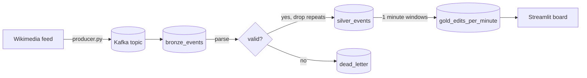

# Wikipedia edit stream

A streaming pipeline on Wikipedia's public feed of recent changes. Every edit, new page and log entry on every Wikimedia site arrives within seconds, goes through Kafka, and ends in a table of edits per wiki per minute that a live board reads.

It answers "which wikis are busiest right now, and how much of that is bots" from a table of a few hundred rows a minute, while the raw feed runs at about 40 events a second.

## What is in it

| | |
|---|---|
| Source | [Wikimedia EventStreams `recentchange`](https://stream.wikimedia.org/v2/stream/recentchange), a public server-sent events feed, no key needed |
| Rate | 3,000 events in 78 seconds from 76 wikis (the saved sample in `sample/`, captured live on 12 November 2026) |
| Broker | Kafka, one node, started by devenv |
| Stream engine | PySpark 4 Structured Streaming, Delta Lake 4 tables |
| Tests | 4, plus a CI run that replays 1,000 events through a real Kafka broker |

## How it works



1. **Producer** (`stream/producer.py`). Reads the feed and writes each event to Kafka, keyed by wiki so one wiki's events stay in order. It asks Kafka for idempotent writes and reconnects with a growing wait when the feed drops.
2. **Bronze** (`stream/run.py`). Spark reads the topic and appends every message as it came, with its Kafka partition, offset and time.
3. **Silver.** Spark reads bronze as a stream, parses the JSON into typed columns, and drops events it has already seen. A message that is not JSON, has no id or has no usable time goes to `dead_letter` with the reason, and the stream keeps running.
4. **Gold.** Spark reads silver as a stream and counts edits, bot edits and net bytes changed per wiki per one-minute window of event time.
5. **Board** (`app/dashboard.py`). Streamlit, refreshing every 10 seconds from the gold table.

### Each stage is its own stream with its own checkpoint

Stopping the job and starting it again continues from where each stage stopped, so nothing is read twice and nothing is skipped. Bronze keeps the raw message, so a change to the parsing rules can be replayed from bronze without asking Kafka or Wikipedia again.

### Repeats are dropped inside a 10 minute watermark

The feed can send an event again after a reconnect. Silver uses `dropDuplicatesWithinWatermark` on the event id, so a repeat that arrives within 10 minutes of event time is dropped and Spark does not have to remember every id forever. The test sends 500 events, repeats the first 40 and checks silver holds 500.

### Gold waits for a minute to close

A window is written once the watermark (2 minutes) passes its end, so a minute shows up on the board about 3 minutes after it happened, and it is final when it appears. The cost is a delay, and the gain is that late events still land in the right minute.

Not handled: one Kafka node, no replication, and Spark runs on the laptop in local mode. Events that arrive more than 10 minutes late can repeat in silver.

## Run it

You need [devenv](https://devenv.sh), which brings Java 17, Python, uv and Kafka.

```sh
devenv up -d                                      # Kafka in the background
devenv shell
uv run pytest                                     # unit tests, plus the Kafka test when the broker is up
uv run python -m stream.producer &                # feed into Kafka
uv run python -m stream.run                       # bronze, silver, dead letter, gold
uv run python -m streamlit run app/dashboard.py   # board at localhost:8501
```

`stream.producer --replay sample/recentchange_sample.jsonl --limit 1000` sends the saved file instead of the live feed, and `stream.run --once` processes what is in Kafka now and stops. CI does exactly that and checks silver holds 1,000 rows. All paths come from `STREAM_PROJECT_DIR` and `STREAM_DATA_DIR`, which devenv sets.
